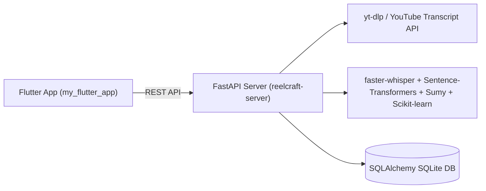

# AI Action Engine (ReelCraft) — Flutter Mobile App & FastAPI AI Server

[](https://github.com/VaibhavBajpaij/AI-Action-Engine)
[](https://github.com/VaibhavBajpaij/AI-Action-Engine)
[](LICENSE)

**AI Action Engine (ReelCraft)** is a cross-platform **Flutter/Dart** mobile client (`my_flutter_app/`) paired with an asynchronous **Python FastAPI + SQLAlchemy** backend (`reelcraft-server/`) for media/transcript extraction, Whisper transcription, text summarization, and semantic action generation.

---

## Architecture



---

## Tech Stack

- **Mobile Client (`my_flutter_app/`):** Flutter, Dart, Provider state management, REST network client, modular screens & services.
- **AI Backend (`reelcraft-server/`):** FastAPI, Uvicorn, SQLAlchemy, `faster-whisper`, `sentence-transformers`, `scikit-learn`, `sumy`, `yt-dlp`, `youtube-transcript-api`, `pytest`.

---

## Quick Start

### Backend Server
```bash
cd reelcraft-server
pip install -r requirements.txt
uvicorn app.main:app --reload
pytest
```

### Flutter App
```bash
cd my_flutter_app
flutter pub get
flutter run
```
